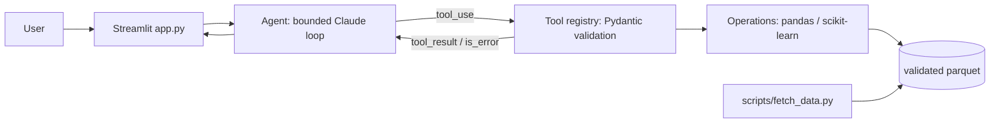

# Architecture

| Component | File | Responsibility |
|---|---|---|
| Data layer | `src/sludgescout/data.py` | Download from the documented source, hash, validate schema and row count, cache as parquet |
| Operations | `src/sludgescout/operations.py` | Deterministic pandas/scikit-learn computations |
| Tools | `src/sludgescout/tools.py` | Bind operations to inspected columns; Pydantic input models built from observed values and ranges |
| Agent | `src/sludgescout/agent.py` | Manual Messages API loop on claude-opus-5-5; progress events; tool errors returned as is_error |
| UI | `app.py` | Streamlit chat with progress states, charts, a direct tool runner, evals and data provenance |
| Evaluation | `src/sludgescout/evaluation.py` | Pinned tool-level checks and agent-level checks |

## Why an agent, and how it is bounded

Questions are open-ended (which tool, which filters, which date) and often need more than one step, so a small tool-using agent fits. It stays bounded: 6 model turns, 8 tool calls, validated inputs, and no code execution. Every number in an answer comes from a tool result.

- Manual Messages API loop: the app controls the budget and streams progress to the UI.
- Tool results go back in one user message per turn; failures are `is_error` results the
  model can correct.
- `stop_reason` handling: `refusal` (with server-side fallback enabled:
  True), `max_tokens`, and the turn limit all end the run with a clear
  status.

## Tool inventory

| Tool | Operation | Bindings |
|---|---|---|
| `rank_countries_by_sludge` | aggregate | group=`geo`, metrics=`['OBS_VALUE']`, filterable=`['ww_tpar', 'ww_tp', 'unit', 'TIME_PERIOD']`, eval_filters=`{'ww_tpar': 'SLD_LAND', 'ww_tp': 'URB_TP', 'unit': 'THS_T', 'TIME_PERIOD': 2022}`, eval_question=`Which country landfilled the most urban sewage sludge (thousand tonnes) in 2022?` |
| `sludge_route_by_year` | aggregate | group=`TIME_PERIOD`, metrics=`['OBS_VALUE']`, filterable=`['geo', 'ww_tpar', 'ww_tp', 'unit']`, eval_filters=`{'geo': 'PL', 'ww_tpar': 'SLD_INCN', 'ww_tp': 'URB_TP', 'unit': 'THS_T'}`, eval_question=`In which year did Poland incinerate the most urban sewage sludge (thousand tonnes)?` |
| `sludge_route_mix` | aggregate | group=`ww_tpar`, metrics=`['OBS_VALUE']`, filterable=`['geo', 'ww_tp', 'unit', 'TIME_PERIOD']`, eval_filters=`{'geo': 'PL', 'ww_tp': 'URB_TP', 'unit': 'THS_T', 'TIME_PERIOD': 2022}`, eval_question=`For Poland in 2022, which sludge category has the largest tonnage?` |
| `cite_sludge_rows` | filter_rows | columns=`['geo', 'ww_tpar', 'ww_tp', 'unit', 'TIME_PERIOD', 'OBS_VALUE', 'OBS_FLAG']`, filterable=`['geo', 'ww_tpar', 'ww_tp', 'unit', 'TIME_PERIOD']`, eval_filters=`{'geo': 'PL', 'ww_tp': 'URB_TP', 'unit': 'THS_T', 'TIME_PERIOD': 2022}`, eval_question=`How many Eurostat rows describe Poland's urban sludge (thousand tonnes) in 2022?` |
| `treatment_coverage_by_country` | aggregate | group=`geo`, metrics=`['OBS_VALUE']`, filterable=`['ww_tp', 'unit', 'TIME_PERIOD']`, eval_filters=`{'ww_tp': 'URB_OTH_CS_T3', 'unit': 'PC', 'TIME_PERIOD': 2022}`, eval_question=`Which country had the highest share of population on tertiary treatment in 2022?` |

Input models are generated from the loaded data, so the JSON schema the model sees lists real
values and ranges, and invalid arguments are rejected before any computation.

## Data flow and validation

1. `fetch_data.py` downloads from the documented source, records SHA-256 hashes in a manifest,
   validates column presence and types and the minimum row count, and writes parquet.
2. The app and scripts load only that validated file. If it is missing, they say so and offer
   the download; they never substitute invented data.

## Evaluation

- Tool-level: expected values pinned by an independent implementation (pyarrow + plain
  Python).
- Agent-level (needs a key): the expected tool is called and the pinned value appears in the
  answer.

## Trade-offs

- Generic, configurable operations instead of bespoke code per tool: easier to validate and
  test, at the cost of some domain-specific nuance.
- Fixed tools instead of model-generated code: safer and reproducible, but questions outside
  the tool set are declined rather than improvised.

